<p align="center"></p>

<p align="center">
<a href="README.md">🇬🇧 English version</a> · <a href="#le-plan-3d-en-direct">Plan 3D</a> · <a href="#les-cartes">Cartes</a> · <a href="#comment-ça-marche">Comment ça marche</a>
</p>

<p align="center">
<b>maison-3d</b> est un projet domotique personnel pour <a href="https://www.home-assistant.io/">Home Assistant</a> :<br>
un <b>plan 3D en direct d'une maison de trois niveaux</b> qui reflète l'état réel des appareils,<br>
et une famille de <b>cartes de tableau de bord</b> écrites de zéro en JavaScript pur (sans framework, sans compilation, sans dépendance).<br>
La maison vient d'une petite <b>chaîne qui transforme un plan <a href="https://www.sweethome3d.com/">Sweet Home 3D</a> en scène glTF légère</b>.
</p>

<p align="center">


</p>

Ce dépôt est une **vitrine du projet et du code qui le fait tourner**, pas un guide d'installation.

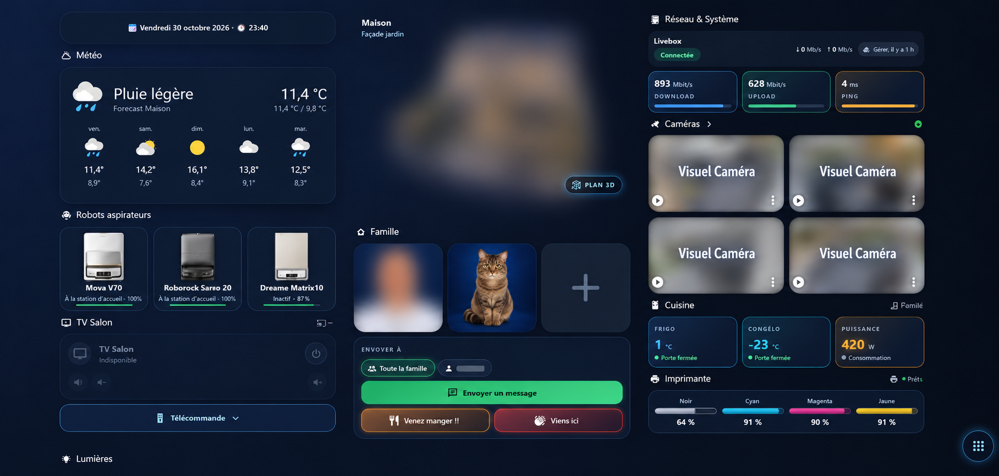

> Visages, vues de la maison et flux des caméras sont floutés. Les autres captures viennent d'une maison jouet générée et d'un faux Home Assistant : aucune vraie maison ni aucun vrai plan n'apparaît dans ce dépôt.

## Le plan 3D en direct

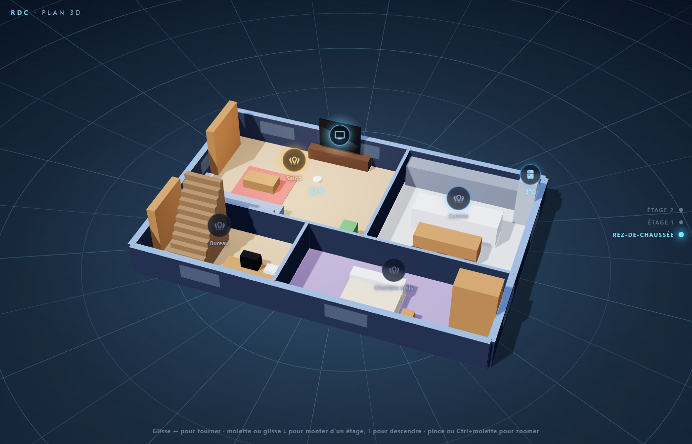

<table>
<tr><td align="center" valign="top"><b>Étage 1</b><br>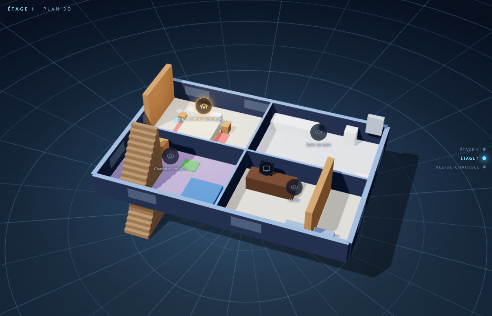</td><td align="center" valign="top"><b>Étage 2</b><br>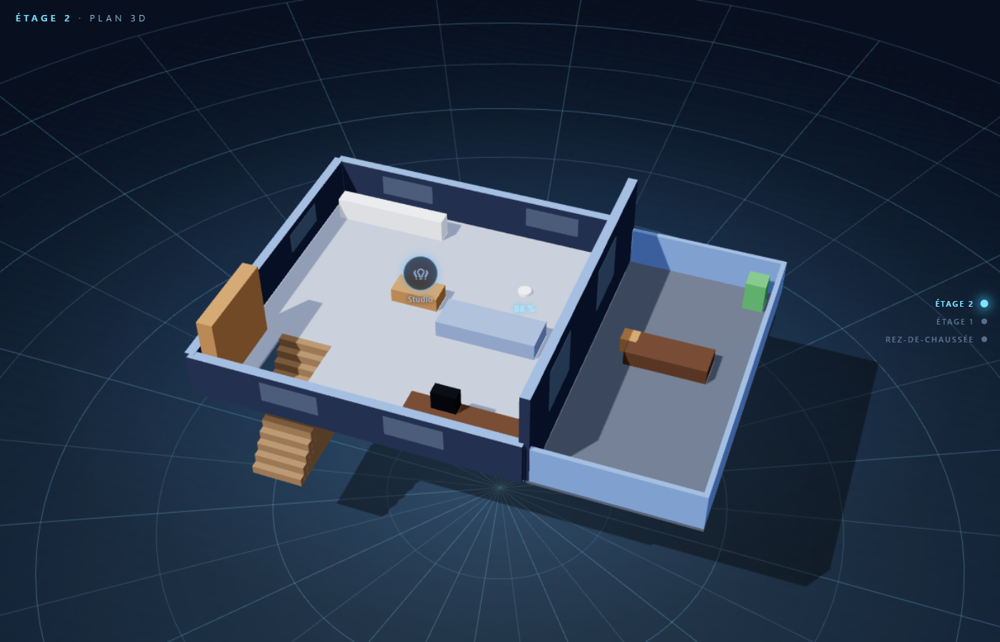</td><td align="center" valign="top"><b>Fiche d'un appareil</b><br>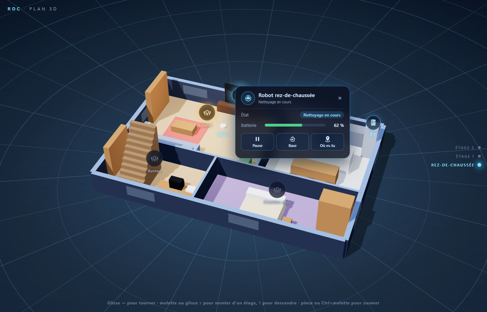</td></tr>
</table>

* rotation à 360°, glisser ou molette pour changer d'étage, pincer pour zoomer — les étages s'empilent et glissent, nombre d'étages quelconque ;
* **un bouton par pièce** allume / éteint les lumières de la zone Home Assistant correspondante ; une pièce allumée brille de la vraie couleur de ses lampes ;
* des **pastilles d'appareils** (TV, robots aspirateurs, température du frigo, box internet, imprimante, litière…) ouvrent une petite fiche liée à des entités en direct ;
* les murs extérieurs **ne s'abaissent que s'ils masquent l'étage affiché**, selon l'angle de la caméra.

### Comment ça marche

```text
plan.sh3d ─ExportObj.java→ export.obj ─build_glb.py→ maison.glb ─hotspots.py→ scene.json ─→ maison-3d-live.js
```

* **Export sans interface** — un court programme Java pilote l'exporteur OBJ de Sweet Home 3D, sans ouvrir de fenêtre.
* **glTF propre** — un nœud par niveau et par mur, meubles fusionnés par matière.
* **Modèle léger** — les meubles détaillés sont allégés : une vraie maison de 3 niveaux passe de 51 Mo à 11,6 Mo.
* **Escaliers** — les volées sont dupliquées à l'étage supérieur pour rester visibles depuis l'étage où elles arrivent.
* **Points d'intérêt** — les noms des meubles sont reliés aux entités Home Assistant, et les murs extérieurs sont trouvés par un test de rayon.
* **Rendu** — three.js à résolution adaptative, une petite réserve de lumières réutilisées, et une boucle qui s'endort quand rien ne bouge.

Plus de détails sur la chaîne : [model3d/README.md](model3d/README.md).

## Les cartes

| Carte | Rôle |
|---|---|
| `maison-3d-live-card` | le plan 3D ci-dessus |
| `maison-interrupteurs-card` | tuiles « interrupteur » qui brillent de la **vraie couleur des lampes**, curseur de luminosité, **ambiances** (scènes), liste de lampes repliable |
| `maison-lumieres-card` | une tuile par pièce à partir du registre des zones (état, couleur, « n/m allumées »), « tout éteindre » |
| `maison-robot-card` | robot aspirateur : état, batterie, démarrer/pause, base, **sélection de plusieurs pièces puis « Nettoyer N pièces »** |
| `maison-salon-card` | TV + barre de son + télécommande (croix, volume, applis) dans une seule interface |
| `maison-litiere-card` `maison-reglages-card` `maison-air-card` `maison-stats-card` | litière (alertes, jauges, actions), réglages repliables, purificateur d'air, chiffres clés |
| `maison-debit-card` `maison-sante-card` `maison-encre-card` `maison-maj-card` | débit internet, santé du système (sauvegardes, alimentation), encre de l'imprimante, mises à jour |
| `maison-frigo-card` | frigo / congélateur (température, consigne, porte, boost), glaçons et filtre à eau |
| `maison-liste-card` `maison-carte-card` `maison-robots-card` `maison-famille-card` `maison-exterieur-card` | listes groupées à barres, carte du robot recadrée avec noms de pièces, sélecteur de robot, actions famille, vues extérieures |
| `maison-nav.js` | **bouton de navigation** flottant fixé en bas à droite : retour à l'accueil ou saut vers n'importe quel onglet |
| `maison-align.js` | étire la dernière carte de chaque colonne pour que toutes finissent au même niveau |

<table>
<tr><td align="center" valign="top"><b>Interrupteurs et ambiances</b><br>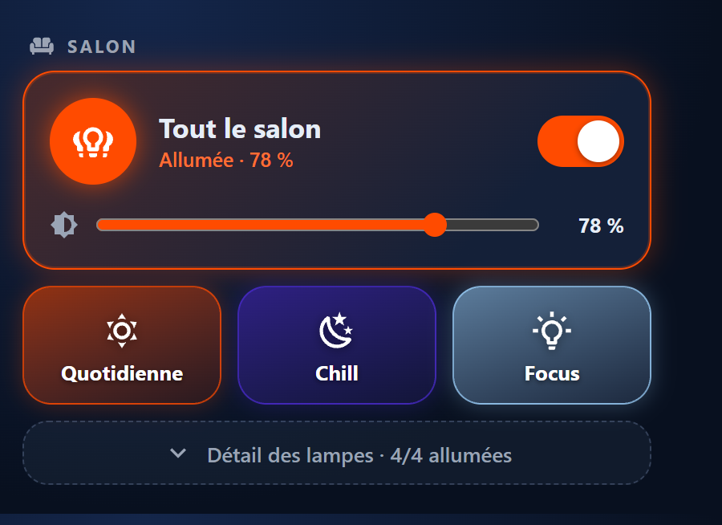</td><td align="center" valign="top"><b>Robot</b><br>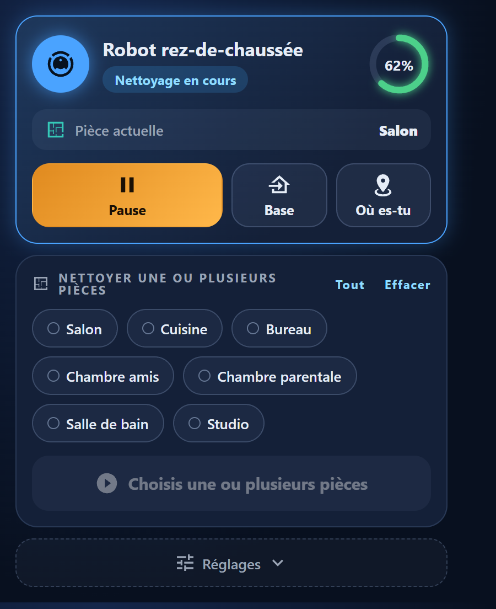</td><td align="center" valign="top"><b>Salon</b><br>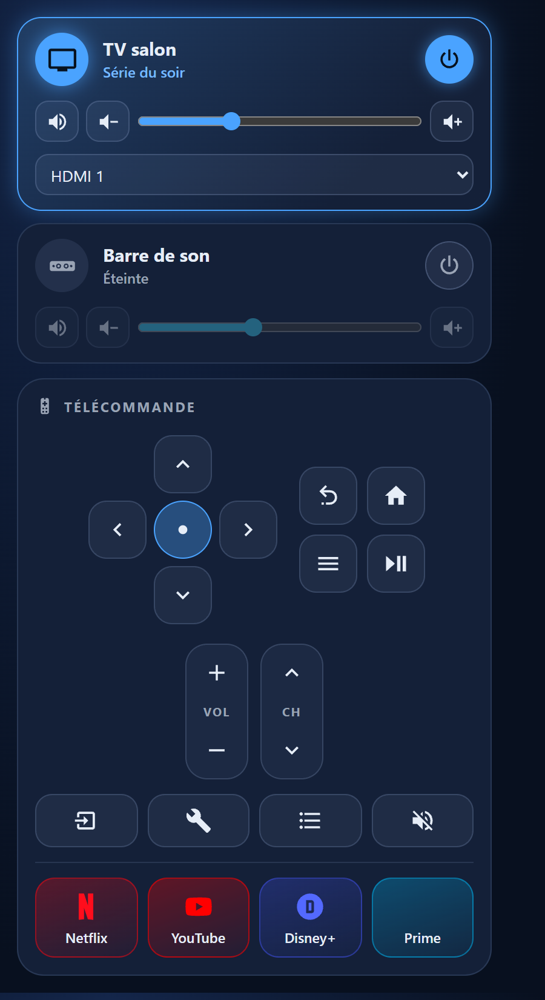</td></tr>
<tr><td align="center" valign="top"><b>Pièces et lumières</b><br>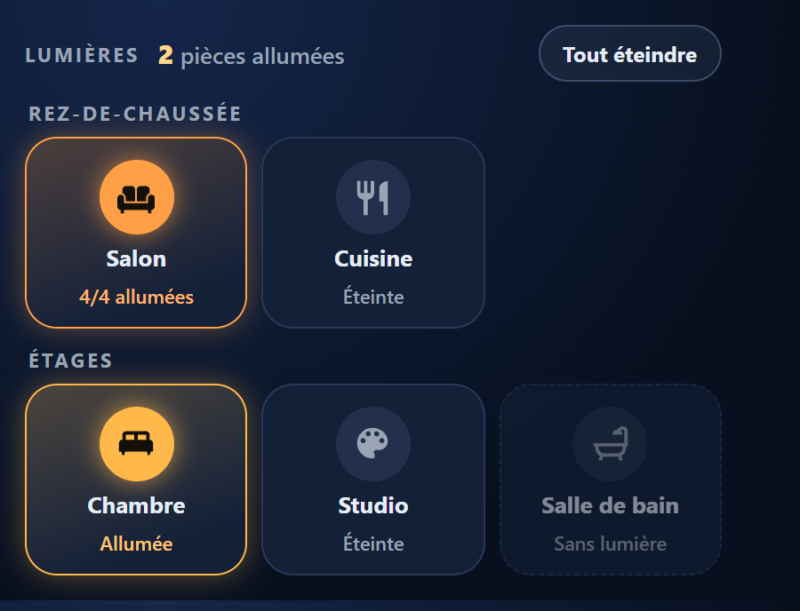</td><td align="center" valign="top"><b>Animaux</b><br>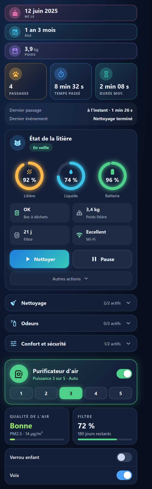</td><td align="center" valign="top"><b>Système</b><br>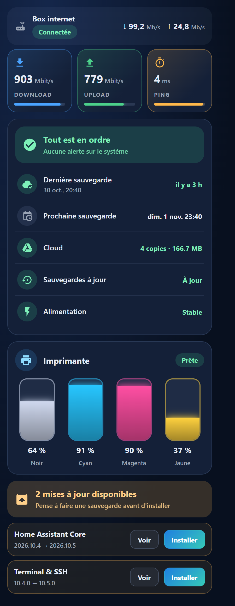</td></tr>
<tr><td align="center" valign="top"><b>Bouton de navigation</b><br>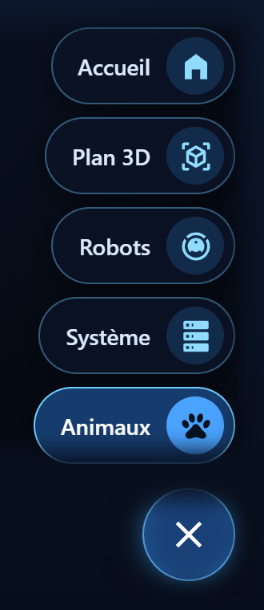</td></tr>
</table>

### Choix de conception

* **Aucune dépendance, aucune compilation.** Chaque carte est un seul fichier lisible qui enregistre un élément personnalisé et suit le thème du tableau de bord grâce aux variables CSS.
* **Tout reflète l'état réel.** Couleurs, compteurs, alertes et « n/m allumées » viennent des états des entités et du registre des zones — rien n'est codé en dur par appareil.
* **Robuste sur une tablette murale.** La carte du robot se recharge quand un onglet en cache revient, et la vue 3D baisse sa résolution quand les images deviennent lentes.
* **Sûr par défaut.** Tout ce qui vient d'une entité (titre média, unité, nom de mise à jour…) est échappé avant d'atteindre le DOM.

Les options de chaque carte sont résumées dans [docs/cards.md](docs/cards.md).

## Contenu du dépôt

```
cards/      les cartes du tableau de bord (un fichier JS chacune)
model3d/    carte 3D en direct + chaîne Sweet Home 3D → glTF (Java, Python)
docs/       référence des cartes, logo et captures
```

## Remarques

* « Lovelace » est le nom officiel du système de tableaux de bord de Home Assistant (en hommage à Ada Lovelace), d'où *cartes Lovelace personnalisées*.
* Les textes de l'interface et les commentaires du code sont en **français** — le projet a été construit pour un foyer français.
* Les identifiants d'entités présents dans les exemples sont fictifs (`*.demo_*`).

## Licence

MIT — voir [LICENSE](LICENSE). Composants tiers : [THIRD_PARTY.md](THIRD_PARTY.md).
