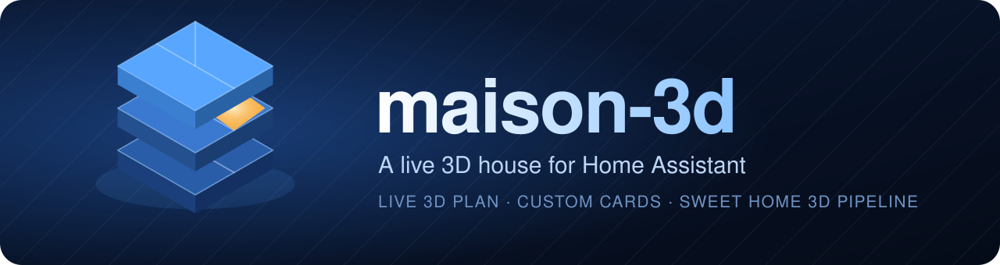

<p align="center"></p>

<p align="center">
<a href="README.fr.md">🇫🇷 Version française</a> · <a href="#the-live-3d-plan">3D plan</a> · <a href="#the-cards">Cards</a> · <a href="#how-it-works">How it works</a>
</p>

**maison-3d** is a personal smart-home project for [Home Assistant](https://www.home-assistant.io/): a **live 3D plan of a three-storey house** that mirrors the real state of its devices, and a family of **dashboard cards** written from scratch in plain JavaScript (no framework, no build step, no dependency).
The house comes from a small **pipeline that turns a [Sweet Home 3D](https://www.sweethome3d.com/) plan into a light glTF scene**.

<p align="center">


</p>

This repository is a **showcase of the project and of the code behind it**, not an installation guide.


> Faces, house views and camera feeds are blurred. The other screenshots come from a generated toy house and a fake Home Assistant: no real home or plan is shown in this repository.

## The live 3D plan


<table>
<tr><td align="center" valign="top"><b>Floor 1</b><br></td><td align="center" valign="top"><b>Floor 2</b><br></td><td align="center" valign="top"><b>Device panel</b><br></td></tr>
</table>

* rotate 360°, swipe or scroll to change floor, pinch to zoom — floors stack and glide in, any number of floors;
* **one button per room** toggles the lights of the matching Home Assistant area; a lit room glows in the real colour of its lamps;
* **device hotspots** (TV, robot vacuums, fridge temperature, router, printer, litter box…) open a small control panel bound to live entities;
* exterior walls **drop to knee height only when they would hide the displayed floor**, decided from the camera angle.

### How it works

```text
plan.sh3d ─ExportObj.java→ export.obj ─build_glb.py→ maison.glb ─hotspots.py→ scene.json ─→ maison-3d-live.js
```

* **Headless export** — a short Java program drives Sweet Home 3D's own OBJ exporter, so no window is needed.
* **Clean glTF** — one node per level and per wall, with furniture merged by material.
* **Light model** — detailed furniture is decimated, taking a real 3-storey house from 51 MB to 11.6 MB.
* **Stairs** — flights are duplicated on the upper level so they stay visible from the floor they reach.
* **Hotspots** — furniture names are matched to Home Assistant entities, and exterior walls are found with a ray test.
* **Rendering** — three.js with adaptive resolution, a small pool of reused lights, and an idle loop when nothing moves.

More on the pipeline in [model3d/README.md](model3d/README.md).

## The cards

| Card | What it does |
|---|---|
| `maison-3d-live-card` | the 3D plan above |
| `maison-interrupteurs-card` | switch-style tiles that glow in the **real colour of the lamps**, brightness slider, **ambiance scenes**, collapsible list of single lamps |
| `maison-lumieres-card` | one tile per room from the area registry (state, colour, “n/m on”), “turn everything off” |
| `maison-robot-card` | vacuum robot: status, battery ring, start/pause, dock, **multi-room selection then “Clean N rooms”** |
| `maison-salon-card` | TV + soundbar + remote control (d-pad, volume, apps) in one interface |
| `maison-litiere-card` `maison-reglages-card` `maison-air-card` `maison-stats-card` | pet litter box (alerts, gauges, actions), collapsible settings, air purifier, big-number stats |
| `maison-debit-card` `maison-sante-card` `maison-encre-card` `maison-maj-card` | network speed, system health (backups, power), printer ink tanks, pending updates |
| `maison-frigo-card` | fridge / freezer (temperature, setpoint, door, boost), ice maker and water filter |
| `maison-liste-card` `maison-carte-card` `maison-robots-card` `maison-famille-card` `maison-exterieur-card` | grouped lists with bars, cropped robot map with room labels, robot picker, family actions, exterior views |
| `maison-nav.js` | floating **navigation button** fixed at the bottom-right: back home, or jump to any tab |
| `maison-align.js` | stretches the last card of each column so all columns end at the same level |

<table>
<tr><td align="center" valign="top"><b>Switches & ambiances</b><br></td><td align="center" valign="top"><b>Robot</b><br></td><td align="center" valign="top"><b>Living room</b><br></td></tr>
<tr><td align="center" valign="top"><b>Rooms & lights</b><br></td><td align="center" valign="top"><b>Pets</b><br></td><td align="center" valign="top"><b>System</b><br></td></tr>
<tr><td align="center" valign="top"><b>Navigation button</b><br></td></tr>
</table>

### Design choices

* **No dependency, no build.** Each card is one readable file that registers a custom element and follows the dashboard theme through CSS variables.
* **Everything reflects real state.** Colours, counters, alerts and “n/m on” come from entity states and the area registry — nothing is hard-coded per device.
* **Resilient on a wall tablet.** The robot map reloads itself when a cached tab comes back, and the 3D view lowers its resolution when frames get slow.
* **Safe by default.** Anything coming from an entity (media title, unit, update name…) is escaped before it reaches the DOM.

The options of each card are summarised in [docs/cards.md](docs/cards.md).

## Repository layout

```
cards/      the dashboard cards (one JS file each)
model3d/    live 3D card + the Sweet Home 3D → glTF pipeline (Java, Python)
docs/       cards reference, logo and screenshots
```

## Notes

* “Lovelace” is the official name of Home Assistant's dashboard system (after Ada Lovelace), hence *Lovelace custom cards*.
* UI strings and code comments are in **French** — the project was built for a French household.
* Entity ids that appear in the examples are fictitious (`*.demo_*`).

## License

MIT — see [LICENSE](LICENSE). Third-party components: [THIRD_PARTY.md](THIRD_PARTY.md).
